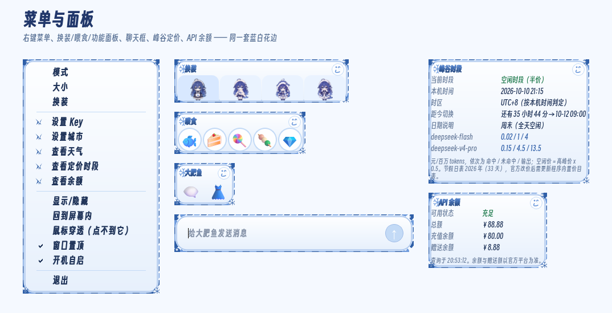
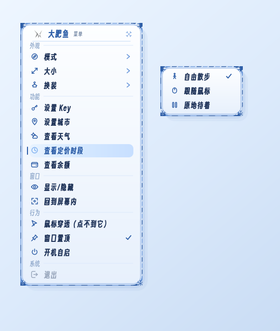

# 大肥鱼桌宠 🐋

DeepSeek V4 Pro 二创形象「鲸鱼娘·大肥鱼」的透明桌面宠物。

基于三视图素材（正面 / 侧面 / 背面），用 Python + PySide6 实现，无边框透明置顶窗口。






> 二次开发 / 接手维护请看 **[MAINTENANCE.md](MAINTENANCE.md)**（架构地图、配置项、素材流水线、线程模型、排错手册）。

## 功能

- **三视图行走**：左右走用侧面（自动镜像）、向上走用背面、向下走用正面

- **三种模式**：自由散步 / 跟随鼠标 / 原地待着（右键菜单切换）

- **互动**：
  - 左键按住：拖拽（会侧身朝向拖动方向，松手会说话）
  - 单击：蹦跳 + 回嘴（互动台词）+ 弹出功能面板（🗨️ 聊天 / 👗 换装）
  - 双击：喂食面板（小鱼干 / 蛋糕 / 棒棒糖 / 团子 / 钻石）
  - 右键：完整菜单（模式 / 大小 / 换装 / 设置 Key / 设置城市 / 查看天气 / 查看定价时段 / 查看余额 / 显示隐藏 / 回到屏幕内 / 鼠标穿透 / 置顶 / 开机自启 / 退出；托盘右键是同款菜单，穿透后可从托盘解除）

- **换装（新增）**：「深海女仆」（最初的深蓝连衣裙形象）之外，还有「居家毛衣」「鲸鱼头套」「雪绒斗篷」三套三视图衣服，左右键菜单里都能切，切换有交叉淡化，选择记在 `config.json` 的 `outfit` 字段里，下次启动自动穿上

- **蓝白花边界面（新增）**：右键菜单、功能面板、喂食面板、换装面板、聊天输入框、说话气泡统一换成「蓝白雪绒」主题
  - 浮层外圈是手绘扇形花边 + 白色珠点 + 四角雪花，内层是蓝白渐变圆角卡片
  - 菜单项悬停/选中是浅蓝渐变底 + 深蓝字，左侧 2px 深蓝指示条；按“外观 / 功能 / 窗口 / 行为 / 系统”分组，10pt 小标题 + 淡蓝细线
  - 菜单项使用 16px 统一线性 SVG 图标（深蓝，悬停浅蓝）；弹出为 130ms 淡入 + 4px 上移，文字颜色有 120ms 过渡；面板带淡蓝灰投影
  - 说话气泡也是花边卡片 + 下方小鲸尾；说话时气泡顶沿还有三片小雪花错相闪烁；心声（思维链）气泡用同款花边的灰调版本
  - **字体（内置，跟随程序走）**：`assets/fonts/` 里放任意 `.ttf/.otf` 就会**自动加载并优先使用**；随包附带**得意黑（Smiley Sans）**，简体风格圆体、SIL OFL 授权可免费商用/可再分发，覆盖项目全部常用字
    - 回退链：内置字体 → 幼圆 → 微软雅黑 → 华文细黑 → 系统默认；气泡 24px、面板 12pt、菜单 11pt
    - **加粗方式**：字重统一用 `Bold(700)`（Qt 只在 ≥700 时才对缺粗体字重的字体做合成加粗），文字另外用 `QPainterPath` 轮廓 + 细描边再补一圈厚度，所以小字号下也不显细
    - **渐变字**：气泡台词与面板标题都是**浅蓝→深蓝竖向渐变**（`TEXT_GRADIENT`，按整条气泡取一次渐变，多行文字连成一体）；心声（思维链）气泡保持灰调纯色，免得和正常台词混在一起
    - 换字体：把 `.ttf/.otf` 丢进 `assets/fonts/` 覆盖掉即可（文件名随意）；想保留系统幼圆就删掉 `assets/fonts/` 里的文件
    - 查看最终用的是哪个字体：`python 桌宠.py --font-check`（会打印内置字体、优先链、气泡/菜单字体与字重）
  - 配色与花边参数集中在 `bubble.py` 顶部（`LACE_*` / `PANEL_*` / `TEXT_*` / `FONT_DIR` / `CUTE_FONT_CANDIDATES`）；菜单专属参数 `MENU_*` 在 `pet_window.py` 顶部

- **台词系统**：日常随机台词 + 互动回嘴 + 思维链心声（灰色斜体括号气泡，小概率冒出），全部取材自社区 DS 梗

- **细节**：呼吸 / 摇摆 / 蹦跳 / 进食动画、转向交叉淡化、加减速惯性、散步自动休息、说话冷却

- 托盘图标、窗口置顶、鼠标穿透、开机自启、配置记忆（config.json）；穿透 / 置顶状态重启后自动恢复

- ##### AI 对话（新增）

  - 左键单击弹出 🗨️ 图标，点击后弹出聊天输入框
  - 调用 DeepSeek API（`deepseek-chat` 模型），每句话不超过 25 字，风格贱兮兮但可爱
  - 对话历史保留最近 40 条（自动记忆上下文）
  - API Key 通过右键菜单「设置 Key」输入，保存到 `config.json`
  - 聊天期间鱼会暂停移动，但呼吸/摇摆/小动作照常

  ##### 天气查询（新增）

  - 右键菜单「查看天气」→ 调用 `wttr.in` 获取当前城市天气
  - 城市默认从 `config.json` 读取，可手动修改配置文件中的 `"city"` 字段
  - 鱼会气泡播报：「汕头今天 26°，天气多云」

  ##### API 余额与峰谷定价（新增）

  - 右键菜单「**查看余额**」→ 请求 `GET https://api.deepseek.com/user/balance`，
    气泡播报一句，并弹出花边面板列出「可用状态 / 总额 / 充值余额 / 赠送余额」（多币种分别列出）
    - 只在点菜单时查询，**有 60 秒冷却**（`balance_cooldown` 可调），冷却内直接复用上次结果，不刷接口
    - 网络请求在后台线程执行、经队列回主线程渲染，不会卡住桌宠
    - Key 无效 / 余额不足 / 请求过频 / 服务异常 / 超时 / 断网 / 响应异常，各有对应中文提示
  - 右键菜单「**查看定价时段**」→ 纯本地计算（零联网、零延迟），弹面板显示：
    当前是高峰还是空闲、距下次切换还有多久、本机时间与时区、日期说明，以及两个模型
    **按当前时段折算后**的单价（缓存命中 / 未命中 / 输出）
  - **峰谷规则**（官方口径）：北京时间**周一至周五（不含中国法定节假日）9:00–12:00、14:00–18:00 为高峰**；
    其余时段（含**周末与法定节假日全天**）为空闲，**空闲价 = 高峰价 × 0.5**
    - 判定一律**按本机本地时间**（面板里会标注 `UTC+8` 之类的偏移）；本机时区不对时请自行校正系统时区
    - 节假日表放在 `assets/holidays/<年>.json`，按自然日生效（调休补班日落在周末仍算谷时）
    - 换年份时用 `python fetch_holidays.py --year 2027` 生成；**没有当年表时状态会显示「时段未知」并退化为按工作日规则估算**，不会瞎猜
    - 想手动指定节假日表：在 `config.json` 里填 `"holiday_override": "D:\\path\\holidays.json"`
  - 命令行自检：`python 桌宠.py --balance-check`（真实查一次余额，退出码 0/1/2）、
    `python 桌宠.py --check`（会附带一段峰谷时段快照，离线可用）

  ##### 系统状态监控（新增）

  - **CPU**：超过 90% 时冒泡提醒
  - **内存**：超过 95% 时冒泡提醒
  - **显卡（NVIDIA）**：温度超过 80°C 时冒泡提醒（`pynvml` 读取）
  - 检测间隔 10 秒，不频繁打扰

## 运行

需要 **Python 3.11+**

> **配置文件**：首次启动会自动生成 `config.json`（含 DeepSeek API Key、位置、外观等），
> 仓库里**不包含**它（已被 `.gitignore` 忽略），请参考 [config.example.json](config.example.json) 自行创建/填写。
> Key 也可以在程序里通过右键菜单「设置 Key」填入，不需要手改文件。

```bash
pip install -r requirements.txt
# 或
pip install PySide6
```

然后双击 `启动桌宠.bat`，或：

```bash
python main.py
# 兼容旧入口：python 桌宠.py
```

### 测试（无头运行，不需要显示器）

```bash
pip install -r requirements-dev.txt
python -m pytest
```

覆盖峰谷判定、配置读写与默认值合并、气泡台词不重复/冷却；测试不会读写真实的 `config.json`。

## 打包成独立 exe（可分享给朋友）

```bash
pip install pyinstaller
pyinstaller --noconfirm --onefile --windowed --name 大肥鱼桌宠 --add-data "sprites;sprites" --add-data "assets;assets" --icon icon.ico main.py
```

产物在 `dist/大肥鱼桌宠.exe`，对方双击即用，无需安装 Python。
（杀毒软件可能对 PyInstaller 产物误报，加信任即可。）

## 推送到自己的 GitHub 仓库

本仓库对应 `https://github.com/decade-0110/dafeiyu_pet.git`（工程文件在仓库根目录）。
代码更新后一条命令即可推送：

```bash
git push -f decade HEAD:refs/heads/main
```

- `git remote -v` 里 `decade` 指向上面那个仓库，`origin` 指向上游原项目 `1190fasheqi/dafeiyu-pet`，别推错。
- 首次推送会弹出 GitHub 登录（浏览器授权或粘贴 Personal Access Token），之后 Git 凭据管理器会记住。
- 推送报 TLS / 凭据类错误时，多半是本机 git 的代理（`http://127.0.0.1:7890`）没开或后端不兼容，按情况二选一：
  ```bash
  # 代理没开：绕过代理直连
  git -c http.proxy= -c https.proxy= push decade HEAD:refs/heads/main
  # 代理开着但报 schannel 凭据错误：换 openssl 后端
  git -c http.sslBackend=openssl push decade HEAD:refs/heads/main
  ```

## 更换形象（重建默认外观「深海女仆」）

默认外观的精灵直接住在 `sprites/` 根目录，用 `--flat` 模式重建：

```bash
# 方式 A：一张并排三视图
python preprocess_outfits.py --id base --name 深海女仆 --src "path\to\三视图.png" --flat --out sprites --force

# 方式 B：三张独立文件（放在同一目录，文件名必须是 正面.png / 侧面.png / 背面.png）
python preprocess_outfits.py --id base --name 深海女仆 --src-dir "path\to\三视图" --flat --out sprites --force
```

`--flat` 会把 `正面/侧面/背面.png` + 各尺寸 + `icon.png` 直接写进 `--out` 目录，不建子目录、不写 `manifest.json`。
建议先加 `--preview --out build\preview` 看棋盘格/白底/深底三行效果，确认没白边再正式生成。

> 侧视图请保持**朝左**（默认外观是这样，程序会在向右走时自动镜像）。
> 万一素材朝右，加 `--flip-side` 即可。

## 给桌宠加一套新衣服

新增的外观放在 `sprites/outfits/<id>/` 里，程序启动时自动发现，菜单里就会出现。

1. 准备白底三视图原图，二选一：**一张并排三视图**（正面 / 侧面 / 背面从左到右），或**三张独立文件**（放同一目录，文件名 `正面.png` / `侧面.png` / `背面.png`）。侧视图朝向要和默认形象一致（朝左）。
2. 先出预览检查抠图质量（棋盘格 / 白底 / 深底三行，方便看白边）：

```bash
# 一张并排图
python preprocess_outfits.py --id my_outfit --name 我的新衣服 --src "path\to\三视图.png" --preview --out build\outfit_preview
# 或三张独立文件
python preprocess_outfits.py --id my_outfit --name 我的新衣服 --src-dir "path\to\三视图" --preview --out build\outfit_preview
```

3. 预览没问题就正式生成精灵（会写 `sprites/outfits/my_outfit/` 和 `manifest.json`）：

```bash
python preprocess_outfits.py --id my_outfit --name 我的新衣服 --src "path\to\三视图.png" --out sprites\outfits
```

4. 重启桌宠（或右键菜单「换装」里选一下）。

常用参数：`--src-dir` 三张独立文件输入、`--flat` 扁平输出（重建默认外观用）、`--side-index 2` 决定哪一格做镜像、`--flip-side` 给侧面做左右镜像、`--force` 覆盖已有精灵。

### 抠图方式：白底泛洪 或 rembg

默认走**白底泛洪**（不需要任何模型，离线可用）。也可以用 [rembg](https://github.com/danielgatis/rembg) 做 AI 抠图，边缘更稳：

```bash
pip install "rembg[cpu]"        # 注意要带 [cpu]，否则只有 rembg 本体、缺 onnxruntime 后端
python preprocess_outfits.py --id my_outfit --name 我的新衣服 --src "path\to\三视图.png" --rembg on
```

> 只装了 `rembg` 而漏掉后端时，程序会直接告诉你缺 onnxruntime（`pip install onnxruntime` 也能补上）。

- `--rembg auto`（默认）：装了 rembg 就自动用，没装就用白底泛洪
- `--rembg on`：强制用 rembg（不可用时提示并退回白底泛洪）
- `--rembg off`：只用白底泛洪
- 首次运行 rembg 会自动下载 u2net 模型（约 176MB，存到 `~/.u2net/u2net.onnx`）；**国内直连 GitHub 容易超时**，可以手动下载后放到该路径：
  `https://gh-proxy.com/https://github.com/danielgatis/rembg/releases/download/v0.0.0/u2net.onnx`
- 本仓库的四套外观（含「居家毛衣」）都是用默认的**白底泛洪**生成的——三视图底色干净时它和 rembg 结果几乎一致（实测同一张图侧面仅差 1px），且不需要模型、离线可用；rembg 更适合底色复杂或不干净的素材
- rembg 报错时会自动回退白底泛洪，不会中断整批处理

自检：`python 桌宠.py --check` 会列出所有外观、每张精灵尺寸和各档位窗口宽高。

## 文件说明

| 文件 | 说明 |
|------|------|
| main.py | 入口：GUI 启动 + `--check` / `--font-check` / `--balance-check` |
| 桌宠.py | 兼容旧入口（转发到 `main.py`） |
| pet_window.py | 窗口、动画、菜单、浮层与面板（Qt） |
| bubble.py | 气泡绘制、字体、台词池、冷却与去重（Qt） |
| outfit.py | 外观发现、精灵加载、尺寸档位（Qt） |
| ai_chat.py | DeepSeek 对话请求 |
| weather.py | 天气查询 |
| balance.py | 余额查询与展示文本 |
| holiday.py | 峰谷判定与节假日表（纯标准库，可单测） |
| config.py | 配置读写、默认值合并、运行路径（纯标准库） |
| tests/ | pytest 用例（无头运行） |
| preprocess_outfits.py | 精灵生成脚本：切三视图 / 抠图（泛洪或 rembg）/ 多尺寸 / manifest；`--flat` 重建默认外观 |
| sprites/ | 默认外观「深海女仆」精灵图（正面/侧面/背面 各尺寸 + 图标） |
| sprites/outfits/ | 各套换装精灵（`<id>/` + `manifest.json`）；打包会自动带上 |
| assets/fonts/ | 内置字体（放 `.ttf/.otf` 即自动加载并优先使用；附得意黑 Smiley Sans，SIL OFL） |
| assets/holidays/ | 峰谷判定用的中国法定节假日表（`<年>.json`，仅节假日自然日；用 `fetch_holidays.py` 生成） |
| fetch_holidays.py | 抓取指定年份节假日并写入 `assets/holidays/` |
| docs/ | README 展示图（四套外观 + 说话气泡 + 菜单与面板 + 右键菜单） |
| MAINTENANCE.md | 维护文档：架构、配置项、素材流水线、线程模型、发布与排错 |
| 启动桌宠.bat | 启动脚本（自动选择 venv 或系统 Python） |
| requirements.txt | 依赖 |
| requirements-dev.txt | 测试依赖（pytest） |
| 桌宠.spec | PyInstaller 打包配置（含新依赖收集） |

## 贡献与致谢

- **AI 对话 / 天气查询 / 系统监控 / PyInstaller 打包配置**：由 [Cpanoe](https://github.com/Cpanoe) 通过 [PR#3](https://github.com/1190fasheqi/dafeiyu-pet/pull/3) 贡献（DeepSeek API 聊天、wttr.in 天气、CPU/内存/GPU 监控、桌宠.spec）。
- 合并时维护方修复：
  - 线程安全：DeepSeek 回复由后台线程直接调用 Qt 界面改为经队列转发主线程（`_say_queue`）
  - 配置保护：`config.json` 保持不入仓库（本地配置含 API Key，防止泄露）
- 桌面宠物朝向修复由 [B-A-A-GE](https://github.com/B-A-A-GE) 通过 [PR#1](https://github.com/1190fasheqi/dafeiyu-pet/pull/1) 提交（未合并，当前为维护方修复版）。

## 台词梗来源

台词均取自 DeepSeek / 鲸鱼娘 / 大肥鱼社区梗（D指导去吃饭、吃白饭、梁文锋会议三连、"才不是大肥鱼"、思维链心声等），感谢社区整活。

## 协议

MIT

## 第三方资源

- **得意黑 Smiley Sans**（`assets/fonts/SmileySans-Oblique.ttf`）—— 由 [Atelier Anchor](https://github.com/atelier-anchor/smiley-sans) 开发，采用 [SIL Open Font License 1.1](https://scripts.sil.org/OFL) 授权，可免费商用、可随程序再分发。
